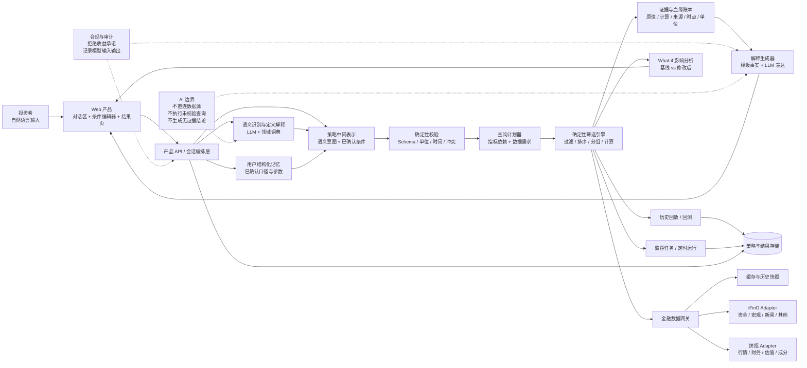
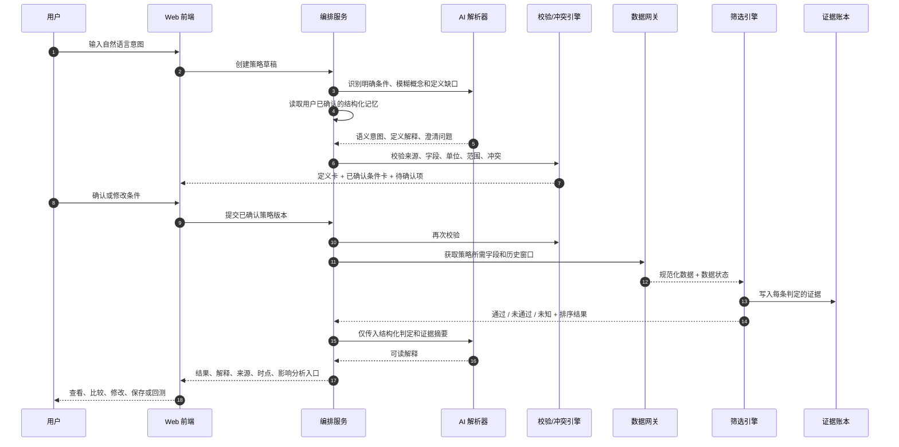

# 自然语言智能选股与策略解释器：初版方案

## 1. 方案定位

产品要解决的核心问题是：投资者可以用“经营改善、估值合理、走势相对稳定”这样的自然语言表达意图，但自然语言本身不能直接作为可靠的筛选条件。系统需要把它变成一份用户可以查看、修改、执行和追溯的策略。

建议把产品主链路固定为：

> 自然语言意图 → 澄清歧义 → 结构化策略 → 冲突与数据检查 → 确定性筛选 → 证据绑定 → 入选/排除解释 → 条件影响分析 → 保存、比较、回测或监控

其中，AI 负责识别语义、解释概念和发起澄清，确定性程序负责校验和计算，金融数据工具负责提供带时点的数据。三者之间通过一个版本化的策略中间表示连接。系统不能因为识别到“经营改善”就自动补出“同比增长大于 10%”这样的执行条件；只有用户在当前输入中明确表达、或此前已经确认并保存为个人默认口径的条件，才能进入可执行筛选。

## 2. 24 小时内的交付目标

### 2.1 必须完成的 MVP

1. 输入一段自然语言选股意图。
2. 识别用户明确表达的条件、模糊语义和已有的用户结构化记忆；不要为没有口径的模糊词自动补阈值。
3. 对没有明确口径的概念先做通俗定义解释，再提出澄清问题；允许用户选择定义、填写参数，或保存为自己的默认口径。
4. 识别硬冲突、软冲突、字段缺失、数据过期和数据源失败。
5. 调用金融数据适配器，由确定性筛选引擎执行条件。
6. 返回候选股票、未通过股票的主要排除原因，以及每个结论对应的来源、时点、单位和原始字段。
7. 修改某一个条件后重新运行，展示候选集合新增、移除和原因变化。
8. 支持策略保存；至少保留回测和监控任务的产品入口与数据结构。若时间允许，再接通一个最小可用版本。

### 2.2 明确不在首版承诺的内容

- 不输出确定性涨跌预测、收益承诺或直接买卖建议。
- 不允许大模型直接执行未经校验的查询语句。
- 不在数据缺失、过期或接口失败时默认为“通过”。
- 不把演示用构造数据伪装成实时金融数据。
- 不在没有足够历史数据和交易规则的情况下声称回测结果具有实盘预测能力。

## 3. 用户核心流程

### 3.1 首次输入

用户输入：

> 想找经营改善、估值合理、走势相对稳定的 A 股。

系统先给出“语义识别结果”，而不是直接生成可执行阈值：

| 用户表达 | 系统先解释的语义 | 当前状态 |
|---|---|---|
| 经营改善 | 企业的收入、利润、利润率、现金流、订单或经营效率等，相比过去出现改善 | 没有用户口径，待定义 |
| 估值合理 | 当前价格相对于企业价值不贵，但“价值”可以用绝对估值、行业比较或自身历史比较来定义 | 没有用户口径，待定义 |
| 走势相对稳定 | 价格波动、回撤或相对基准的波动较小，但需要明确指标、窗口和基准 | 没有用户口径，待定义 |
| 股票范围 | A 股普通股，排除 ST、停牌和关键字段缺失标的 | 产品建议，可修改 |
| 数据时点 | 最近一个完整交易日和最近一期可获得财报 | 产品建议，可修改 |

系统按照以下顺序决定是否生成执行条件：

1. **读取当前自然语言中的明确表达**。例如用户说“最近两年净利润同比增长超过 20%”，可以直接解析为明确条件，并标记为“用户明确表达”。
2. **读取用户结构化记忆**。如果用户过去已经确认过“经营改善 = 最近四个季度营业收入和归母净利润同比均为正”，系统可以把它直接带入本次策略作为“用户默认口径”，并清楚展示来源、版本和确认时间；用户可以在本次策略中覆盖或关闭它。如果当前自然语言与记忆冲突，则必须让用户选择采用哪一个。
3. **解释模糊概念并请求定义**。如果当前表达和用户记忆都没有给出口径，系统不能自行补出阈值或指标，而应先解释这个词通常可以怎样定义，再让用户选择或填写。

例如用户不懂“经营改善”是什么意思时，页面可以用通俗语言展示：

- **增长型定义**：收入、利润相较过去增长，关注企业规模是否变大。
- **盈利能力型定义**：毛利率、净利率、ROE 等改善，关注赚钱效率是否变好。
- **现金流型定义**：经营现金流改善或持续为正，关注利润是否有现金支持。
- **组合定义**：同时满足增长、盈利能力和现金流中的若干项。

这只是定义解释，不代表系统已经替用户选择了某种标准。用户选定定义后，系统再询问窗口、阈值、基准和是否保存为个人默认口径。未完成定义的语义不能进入筛选执行。

### 3.2 修改与执行

策略编辑器需要区分“概念定义卡”和“可执行条件卡”：

- 概念定义卡展示用户原话、通俗定义、可选定义方式和待回答的问题。
- 可执行条件卡展示指标、运算符、阈值、单位、观察窗口、基准和数据时点。
- 每个可执行条件都标记来源：用户当前明确表达、用户结构化记忆，或用户刚刚确认的定义。
- AI 生成的候选定义只能标记为“建议”，不能标记为已执行条件。
- 当前状态至少包括：已确认、待定义、待填写参数、冲突、数据不可用。

当用户完成定义后，例如确认“经营改善”使用“最近四个季度营业收入同比增长和归母净利润同比增长”，再由用户填写或确认阈值。此时用户把净利润同比增长阈值从 10% 改成 20%，系统重新执行，并展示：

- 新增入选数量和移除数量。
- 新增标的、移除标的。
- 各条件的通过率变化。
- 因阈值变化而被排除的主要标的和实际值。
- 如果没有结果，说明是哪条条件导致候选集合收缩，而不是只显示“没有找到股票”。

### 3.3 结果解释

每只股票的结果拆成四部分：

1. **事实**：原始字段值、计算值、单位、来源和时点。
2. **判定**：与策略条件比较后的通过、未通过或未知。
3. **解释**：为什么入选、为什么排除。
4. **不确定性**：缺失字段、数据延迟、多个数据源不一致或统计窗口不足。

“未知”必须与“未通过”分开。比如 PE 数据缺失时，不能把股票判定为“不满足估值条件”；应显示“无法判定：PE-TTM 数据缺失”。

## 4. 模块拆解

| 模块 | 核心职责 | 首版实现 | 后续增强 |
|---|---|---|---|
| 输入与会话 | 接收自然语言，保留多轮上下文、策略版本和用户口径记忆 | 单策略会话 | 多策略工作区、权限和协作 |
| 意图解析器 | 区分用户明确表达、模糊概念和已有结构化记忆，不擅自补阈值 | LLM 结构化输出 | 领域词典、历史修正学习、语义置信度校准 |
| 定义解释器 | 用通俗语言解释“经营改善”等概念的常见定义，帮助用户选择 | 预置定义卡片 + LLM 改写 | 按用户知识水平个性化解释 |
| 澄清问题生成器 | 找出缺失的定义、指标、窗口、阈值、基准和数据时点 | 规则 + LLM 生成问题 | 基于结果敏感度动态排序问题 |
| 用户口径记忆 | 保存用户明确确认过的概念定义和参数，供后续提示沿用 | SQLite 保存版本、来源和确认时间 | 跨策略复用、口径冲突提醒 |
| 策略中间表示 | 分离语义意图、定义候选和已确认的可执行条件 | JSON + Pydantic 校验 | 版本化 DSL、跨产品复用 |
| 条件编辑器 | 先展示概念定义卡，确认后再展示可执行条件卡 | 条件卡片 + 结构化表单 | 可视化流程编排、自然语言与表单双向同步 |
| 冲突分析器 | 检查条件矛盾、不可满足组合、数据和单位问题 | 确定性规则 | 统计冲突、样本量预测、自动放宽建议 |
| 数据适配层 | 统一扶摇、iFinD 或其他数据源的字段和错误 | Provider Adapter 接口 | 多源交叉验证、故障切换、缓存和限流 |
| 指标计算层 | 计算同比、波动率、最大回撤、分位数等 | Python/Polars 或 Pandas | DuckDB、增量计算、指标注册中心 |
| 确定性筛选引擎 | 按策略 AST 执行过滤、排序、分组和打分 | 白名单 AST + 本地数据集 | 分布式查询、复杂因子组合、实时流式筛选 |
| 证据与血缘 | 记录每个结论依赖的字段、原值、计算过程、来源和时点 | Evidence Ledger | 可复现快照、数据版本和审计导出 |
| 解释器 | 把判定和证据转成可读的入选/排除说明 | 模板优先，LLM 润色 | 个性化解释深度、解释质量评估 |
| 影响分析 | 比较条件修改前后的结果差异 | 双跑 diff | 反事实分析、敏感度曲线、Pareto 前沿 |
| 比较与保存 | 比较股票、保存策略和结果快照 | SQLite 保存 | 收藏夹、分享、版本回滚 |
| 回测 | 按历史时点重复执行策略 | 最小历史回放 | 交易成本、停牌、涨跌停、财报可得性和幸存者偏差校正 |
| 监控任务 | 定期运行策略并提示条件变化 | 任务结构和手动触发 | 定时调度、阈值告警、数据质量告警 |
| 合规与审计 | 区分事实、推断和不确定性，阻止投资承诺 | 输出规则和日志 | 审核台、敏感请求分类、全链路审计 |

## 5. 总体架构图

下面的图可以直接放进 README 或答辩文档中。实线表示正常数据流，虚线表示 AI 只做辅助，不直接拥有金融计算和执行权限。



### 5.1 关键边界

- **AI 层**：识别用户明确表达和模糊概念，读取用户已确认的口径记忆，用通俗语言解释候选定义并提出澄清问题。它可以生成“定义建议”，但不能自行生成未被用户确认的阈值、指标组合或执行条件；输出必须符合 JSON Schema，并带有来源和语义置信度。
- **确定性层**：验证策略、识别未定义意图、检查冲突、计算指标、执行过滤、归纳通过/未通过/未知、生成差异结果。只有用户明确表达或确认过的条件才能进入执行。该层不接受大模型生成的自由文本作为执行指令。
- **数据层**：返回真实字段和元数据，包括证券代码、字段名、数值、单位、来源、披露时间、行情时间、数据状态和错误信息。
- **解释层**：只能使用证据账本中的事实和计算结果。大模型可以改变表达方式，不能改变数字、方向或判定。

## 6. 主链路时序图



## 7. 策略中间表示 Strategy IR

策略中间表示是整个系统的稳定接口。建议首版用 Pydantic 定义，前后端共享 JSON 示例；后续可以再演化为正式 DSL。

```json
{
  "strategy_id": "draft_001",
  "version": 3,
  "execution_status": "blocked_pending_clarification",
  "universe": {
    "market": ["CN_A"],
    "security_type": ["common_stock"],
    "exclude": ["ST", "suspended"],
    "as_of": "latest_complete_trading_day",
    "origin": "system_suggestion"
  },
  "semantic_intents": [
    {
      "text": "经营改善",
      "concept_id": "operating_improvement",
      "origin": "explicit_user",
      "definition_status": "needs_clarification",
      "semantic_confidence": 0.96,
      "explanation": "企业的收入、利润、盈利能力、现金流或经营效率相较过去变好",
      "definition_candidates": [
        {"id": "growth", "label": "增长型", "executable": false},
        {"id": "profitability", "label": "盈利能力型", "executable": false},
        {"id": "cashflow", "label": "现金流型", "executable": false},
        {"id": "composite", "label": "组合型", "executable": false}
      ],
      "needs_confirmation": true
    },
    {
      "text": "估值合理",
      "concept_id": "reasonable_valuation",
      "origin": "explicit_user",
      "definition_status": "needs_clarification",
      "semantic_confidence": 0.94,
      "explanation": "当前价格相对于企业价值不贵，需要明确绝对、行业相对或历史相对口径",
      "definition_candidates": [
        {"id": "absolute", "label": "绝对阈值", "executable": false},
        {"id": "industry_relative", "label": "行业相对", "executable": false},
        {"id": "history_relative", "label": "历史相对", "executable": false}
      ],
      "needs_confirmation": true
    },
    {
      "text": "走势相对稳定",
      "concept_id": "price_stability",
      "origin": "explicit_user",
      "definition_status": "needs_clarification",
      "semantic_confidence": 0.91,
      "explanation": "价格波动、回撤或相对基准的波动较小，需要明确指标、窗口和基准",
      "definition_candidates": [
        {"id": "volatility", "label": "波动率", "executable": false},
        {"id": "drawdown", "label": "最大回撤", "executable": false},
        {"id": "relative_stability", "label": "相对基准稳定", "executable": false}
      ],
      "needs_confirmation": true
    }
  ],
  "user_memory": {
    "matched_definitions": [],
    "memory_action": "ask_before_create"
  },
  "conditions": [],
  "ranking": {
    "status": "pending_confirmation",
    "metrics": [],
    "top_k": 20
  },
  "missing_data_policy": "unknown",
  "data_requirements": {
    "max_age": "provider_defined",
    "allow_cross_provider_fill": false
  }
}
```

当用户明确表达或确认了定义后，`conditions` 才能写入可执行条件。例如用户确认“经营改善”采用收入和归母净利润同比增长，并确认阈值后，条件来源应写成 `explicit_user` 或 `user_memory`，而不是 `ai_inferred`：

```json
{
  "id": "c_revenue_growth",
  "group": "经营改善",
  "metric": "revenue_yoy",
  "operator": ">=",
  "value": 10,
  "unit": "pct",
  "window": {"type": "latest_four_quarters"},
  "hard": true,
  "origin": "user_memory",
  "memory_id": "mem_operating_improvement_v2",
  "confirmed_at": "[timestamp]",
  "needs_confirmation": false
}
```

### 7.1 为什么要保留 origin、semantic_confidence 和 needs_confirmation

“估值合理”或“经营改善”并没有唯一的金融定义。AI 可以识别用户可能指向的概念，并解释常见定义，但不能把某个指标、阈值和时间窗口伪装成用户已经明确说过的条件。

因此需要区分两层信息：

- **语义层**：记录用户说了什么、系统如何理解、有哪些定义候选以及语义识别置信度。
- **执行层**：只有用户当前明确表达、用户此前确认并保存的结构化记忆，或用户在当前页面明确选择并确认的条件，才能进入 `conditions`。

`origin` 只允许使用 `explicit_user`、`user_memory`、`user_confirmed` 等可追溯来源；`ai_inferred` 可以用于描述语义映射，但不能作为可执行条件的来源。没有完成定义的语义意图必须保持 `needs_confirmation: true`，并将策略状态置为 `blocked_pending_clarification`。

### 7.2 执行状态

每个条件和每只股票都使用统一状态：

- `pass`：字段齐全，计算成功，满足条件。
- `fail`：字段齐全，计算成功，不满足条件。
- `unknown`：字段缺失、过期、时间窗口不足、接口失败或数据冲突，无法安全判定。
- `not_applicable`：该条件对当前股票或当前市场范围不适用。

`unknown` 不应被当作 `fail`，也不应被当作 `pass`。

## 8. 冲突识别规则

### 8.1 硬冲突

这类问题可以确定地判断，不应交给模型猜：

- 同一指标同时要求 `>= 20` 和 `<= 10`。
- 时间窗口结束时间早于开始时间。
- 分位数下界大于上界。
- 条件引用不存在的字段或不允许的单位。
- 用户指定的市场范围与证券类型不兼容。
- “经营改善”等语义没有当前用户表达，也没有可复用的用户结构化记忆。
- 用户当前明确口径与已保存记忆不一致，但没有选择采用哪一个。

处理方式：

- 对数值和类型冲突，阻止执行并让用户修改策略。
- 对未定义概念，先展示定义解释和可选口径，不能直接执行。
- 对记忆冲突，明确提示“当前输入”和“已保存口径”的差异，由用户选择后再生成条件。

### 8.2 软冲突

这类组合不一定逻辑矛盾，但可能导致结果很少：

- 高增长、高股息、低估值、低波动同时要求很严格。
- 经营改善条件要求最新财报，但用户还要求只保留最近 5 个交易日成立的公司。
- 行业分位数条件在小行业样本中不稳定。

处理方式：允许执行，但提前提示预计候选量可能较低，并提供放宽一个条件的影响预览。

### 8.3 数据冲突

- 两个数据源同一时点的关键值差异超过容差。
- 财务报表披露日期晚于用户要求的回测时点。
- 行情数据未覆盖完整窗口。
- 数据接口返回成功，但字段为空或带有明确错误码。

处理方式：展示冲突详情，标记为 `unknown`，保存原始响应摘要和请求时间。

## 9. 筛选引擎设计

### 9.1 执行原则

1. LLM 先生成“语义意图、定义解释和澄清问题”；只有用户明确表达或确认后的内容，才能生成结构化执行条件。
2. LLM 不生成可以直接执行的 SQL 或 Python，也不能自行补出阈值、指标组合或时间窗口。
3. 所有指标、操作符、单位和函数必须来自白名单注册表。
4. 查询计划由后端根据已确认的策略 AST 生成；存在未定义意图时，策略保持待澄清状态。
5. 每次筛选保存策略版本、数据快照标识和执行时间。
6. 每个判定都生成证据记录，而不是只返回最终布尔值。

### 9.2 证据记录建议结构

```json
{
  "run_id": "run_20261012_001",
  "symbol": "600000.SH",
  "condition_id": "c_revenue_growth",
  "metric": "revenue_yoy",
  "raw_fields": [
    {"name": "revenue_current", "value": "[provider_value]", "unit": "CNY", "as_of": "[date]"},
    {"name": "revenue_previous", "value": "[provider_value]", "unit": "CNY", "as_of": "[date]"}
  ],
  "derived_value": "[calculated_value]",
  "derived_unit": "pct",
  "operator": ">=",
  "threshold": 10,
  "status": "pass",
  "provider": "fuyao",
  "retrieved_at": "[timestamp]",
  "data_quality": "ok"
}
```

上面的方括号内容只能在真实数据返回后填充，不能用演示值冒充来源数据。

### 9.3 结果页建议

结果页分为三个视图：

- **入选**：展示通过条件数、关键事实、综合排序分数以及数据来源。
- **排除**：展示主要失败条件、实际值、阈值和失败数量；如果是 `unknown`，单独列出原因。
- **数据质量**：展示缺失字段、过期数据、接口异常和多源冲突。

## 10. 初版技术架构

### 10.1 推荐技术栈

- 前端：Next.js + TypeScript + Tailwind CSS；用表格、条件卡片和对话组件完成主链路。
- 后端：FastAPI + Pydantic；负责策略解析、校验、筛选、证据和结果接口。
- 指标计算：首版使用 Polars 或 Pandas；用 DuckDB 读取历史快照，减少复杂数据库建设。
- 存储：SQLite 负责策略、运行记录、证据和用户构造数据；部署版可替换 PostgreSQL。
- AI：封装为 `LLMProvider`，强制使用结构化输出；具体模型可通过环境变量替换。
- 外部数据：实现 `MarketDataProvider` 接口，分别封装扶摇和 iFinD，禁止前端直接调用供应商接口。
- 任务调度：首版用 APScheduler 或平台定时任务；生产版再考虑 Celery、队列或工作流引擎。

### 10.2 建议目录

```text
project/
├── apps/
│   ├── web/                         # Next.js 前端
│   └── api/                         # FastAPI 服务
├── packages/
│   ├── strategy-schema/             # Strategy IR、枚举、版本
│   ├── screening-engine/            # 条件编译、指标计算、判定
│   ├── data-contracts/              # 供应商统一字段和数据质量状态
│   └── explanation/                # 证据转解释模板
├── providers/
│   ├── fuyao_adapter/
│   ├── ifind_adapter/
│   └── cached_snapshot/
├── tests/
│   ├── unit/
│   ├── integration/
│   ├── failure_injection/
│   └── compliance/
├── docs/
│   ├── architecture.md
│   ├── ai-validation-log.md
│   └── test-report.md
├── .env.example
└── README.md
```

### 10.3 首版 API

```text
POST /api/strategies/parse
POST /api/strategies/{strategy_id}/clarify
POST /api/strategies/{strategy_id}/validate
POST /api/strategies/{strategy_id}/runs
GET  /api/runs/{run_id}/results
GET  /api/runs/{run_id}/evidence/{symbol}
POST /api/runs/{run_id}/what-if
POST /api/strategies/{strategy_id}/backtests
POST /api/strategies/{strategy_id}/monitors
GET  /api/strategies/{strategy_id}/versions
```

`POST /api/strategies/{strategy_id}/runs` 的返回值必须包含 `run_id`、策略版本、数据时点、数据源状态和结果状态，不能只返回股票代码列表。

## 11. 24 小时开发路线

### 0—2 小时：冻结范围和数据契约

- 确认产品主链路和演示口径。
- 定义 Strategy IR、SemanticIntent、DefinitionCandidate、Condition、Evidence、Result 状态。
- 定义“已确认条件”和“待澄清语义”不能混用的状态机。
- 选定至少一套可调用的数据来源和一个本地缓存方案。
- 建立空的 README、环境变量示例和不提交密钥的规则。

### 2—6 小时：实现核心后端

- 实现 Strategy IR 的 Pydantic 校验。
- 实现指标注册表、操作符白名单和冲突规则。
- 实现数据适配器接口和一个真实数据适配器。
- 实现确定性筛选、`pass/fail/unknown` 和证据账本。

### 6—10 小时：接入 AI 解析和澄清

- 设计结构化输出提示词，要求区分明确条件、模糊概念、用户记忆和定义缺口。
- 将自然语言先映射为语义意图和定义候选，不能直接映射成未经确认的阈值条件。
- 增加定义解释、歧义识别和澄清问题。
- 对 AI 输出做 schema 校验，失败时回退到人工编辑模式；未确认的条件不得进入筛选引擎。

### 10—15 小时：实现前端主链路

- 对话输入。
- 条件编辑器。
- 冲突提示和数据状态提示。
- 结果表、入选/排除/未知三个视图。
- 单只股票的解释和证据抽屉。

### 15—18 小时：实现 what-if、保存和最小回测/监控入口

- 保存策略版本。
- 修改一个阈值后重新运行并生成 diff。
- 如果历史数据足够，接入一个固定日期区间的最小回放。
- 否则保留真实入口和清晰的“数据不足”状态，不伪造回测图。

### 18—21 小时：测试与异常注入

- 主链路集成测试。
- 空结果、缺失字段、接口超时、过期数据、多源冲突测试。
- 反向边界测试：要求买入、保证收益、预测确定涨跌时的合规处理。
- 数字、来源和时点回溯测试。

### 21—24 小时：部署、演示和提交材料

- 部署 Web 产品。
- 用固定演示输入跑通完整路径。
- 整理 README、AI 使用记录、测试说明和已知边界。
- 录制 60—180 秒演示视频或准备演示脚本。

## 12. 测试与验收矩阵

| 场景 | 预期结果 |
|---|---|
| 用户明确说出指标、阈值和窗口 | 生成可执行结构化策略并成功筛选 |
| “经营改善”等概念没有明确口径 | 先解释概念和可选定义，不能自动生成阈值；等待用户确认 |
| 用户不懂“经营改善”是什么意思 | 用增长、盈利能力、现金流等通俗定义卡解释，再让用户选择 |
| 用户此前保存过“经营改善”的口径 | 提示沿用用户结构化记忆，允许本次覆盖或确认后执行 |
| “估值合理”没有明确口径 | 标记待定义，提出绝对、行业相对、历史相对等选项 |
| 下界大于上界 | 阻止运行，显示冲突位置和修改建议 |
| 字段缺失 | 标记 `unknown`，不能自动通过或失败 |
| 数据接口超时 | 显示数据源异常，保留运行状态，不能静默使用空值 |
| 行情窗口不足 | 标记窗口不足，不能计算稳定性指标 |
| 两数据源值不一致 | 显示冲突和来源，按策略决定是否暂停该条件 |
| 结果数量为 0 | 显示导致收缩最大的条件和放宽后的影响预览 |
| 用户修改阈值 | 显示新增、移除和原因变化 |
| 回测数据存在未来信息 | 测试失败；财报只能在披露日之后进入可用数据集 |
| 用户要求“保证上涨” | 转为风险/条件分析，禁止确定性收益承诺 |
| 供应商返回异常状态码 | 显示失败原因和可重试入口，不生成正常结论 |
| 关键数字解释 | 可回溯至原字段、计算公式、单位、来源和时点 |

## 13. 初版方案的优化点

### P0：上线前必须补齐

1. **策略和结果版本化**：同一个策略在不同时间执行的结果必须可区分。
2. **数据质量状态一等公民**：过期、缺失、冲突、接口失败不能被当作普通空值。
3. **证据账本**：所有关键数字都要能点开看到原始字段和计算过程。
4. **语义与执行分离**：AI 可以解释“经营改善”等概念，但不能把自己推断的阈值或指标组合静默写成用户条件。
5. **结构化记忆可追溯**：只有用户明确确认并保存的口径才能跨策略复用，且每次沿用都展示来源、版本和确认时间。
6. **回测防未来信息**：严格按当时可获得的披露信息构建历史数据。
7. **合规输出规则**：禁止确定性涨跌预测和收益承诺，事实、推断、不确定性分栏展示。

### P1：完成主链路后优先增强

1. 根据候选定义的影响范围和用户知识水平排序澄清问题，让用户先回答最影响结果的问题。
2. 增加用户结构化记忆，让用户确认过的“经营改善”“估值合理”等口径可以复用、覆盖和回滚。
3. 用行业相对估值、基准相对波动等“相对条件”作为可选定义，而不是系统默认的唯一答案。
4. 增加条件影响曲线，例如用户确认净利润增速阈值后，再观察从 10% 调到 20% 时的候选数量变化。
5. 增加结果比较卡片，让用户并排查看增长、估值、波动、回撤和数据质量。
6. 增加数据源故障切换和缓存快照，但始终展示当前使用的实际来源。
7. 用模板生成金融解释，再让 LLM 做语言润色，以降低数字改写风险。

### P2：产品化阶段再做

1. 引入策略模板市场，例如“低波动价值”“盈利修复”“质量成长”。
2. 支持自然语言和结构化条件的双向同步编辑。
3. 增加组合级约束、行业暴露、流动性和换手控制。
4. 支持用户保存的监控规则和基于变化原因的通知。
5. 建立解释质量评估集，评估事实一致性、覆盖率、可读性和用户修改率。
6. 在有足够历史数据后，加入交易成本、滑点、停牌、涨跌停、幸存者偏差和数据修订处理。

## 14. 演示脚本建议

60—180 秒演示可以只展示一条主线：

1. 输入“找经营改善、估值合理、走势相对稳定的 A 股”。
2. 展示系统识别出三个语义概念，但没有直接生成同比阈值、PE 分位或波动率倍数。
3. 用户打开“经营改善”的定义解释，选择增长型、盈利能力型、现金流型或组合型，并填写或确认参数；对“估值合理”和“走势稳定”做同样处理。
4. 用户确认后点击运行，展示入选、排除和未知三个结果区。
5. 打开一只入选股票，查看通过条件、字段值、来源、时点和单位。
6. 打开一只排除股票，查看具体失败条件和实际值。
7. 在条件已经由用户确认后，把净利润增速阈值从 10% 改成 20%，展示结果差异和候选数量变化。
8. 保存策略，展示回测或监控入口以及数据质量提示。

演示中应明确说“这是基于当前数据口径的条件筛选和解释”，避免把产品描述成预测或荐股工具。

## 15. README 和提交材料清单

- 可访问 Web 产品 URL。
- 源代码仓库。
- 启动方式和环境变量说明。
- AI 角色、提示词结构化输出和人工修正记录。
- 数据来源、字段口径、时间点和调用失败处理。
- 主链路测试、异常测试、合规测试报告。
- 已知限制和未实现事项。
- 不提交 API Key、用户隐私和受限数据。
- 可选的演示视频或固定演示脚本。
